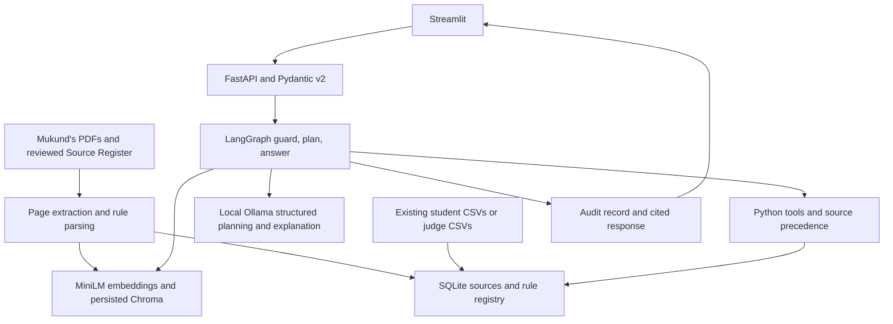

# HCL university student services assistant

Integrated application: Mukund's `mukund2` PDF collection plus the team's existing synthetic student database and university assistant. The branch history is retained. The API, retrieval and calculators share one SQLite database and one persisted Chroma collection; we do not maintain two competing stores.

This is a verified integration candidate, not a claim that every competition requirement has been completed. Read [requirements status](docs/REQUIREMENTS_STATUS.md) before presenting it. In particular, the retained student data was generated by deterministic Python, not by an LLM; no provenance has been invented.

## Start on Windows

Install Python 3.12, open this repository folder in VS Code and run:

```powershell
py scripts\start_demo.py
```

The launcher creates `.venv`, installs missing dependencies, loads the existing student CSVs only into an empty database, indexes three reviewed NITJ documents, then starts FastAPI on port 8000 and Streamlit on port 8501. Keep the terminal open. First use downloads MiniLM and can take several minutes. This default is explicitly **mock LLM mode**; the actual embeddings, databases, API and Python calculations are used.

For the optional conflict and placement demonstrations:

```powershell
py scripts\start_demo.py --include-synthetic
```

This uses a separate `runtime/nitj-demo` directory unless you explicitly set `DATA_DIR`. It adds exactly two fictional policies, clearly identified in answers and the source register. They are not NITJ policies. Official-only mode uses `runtime/nitj` and does not manufacture a placement threshold. Do not mix the two modes by manually reusing a data directory.

For the required local LLM, install and start Ollama, then:

```powershell
ollama pull qwen2.5:7b-instruct
py scripts\start_demo.py --real-llm
```

Use `--real-llm --include-synthetic` to combine real inference with the clearly labelled fictional demonstrations. A model failure returns HTTP 503 instead of silently replacing Ollama with a mock. Actual Ollama quality and latency still require verification on the team's laptop.

API docs: `http://127.0.0.1:8000/docs`. UI: `http://127.0.0.1:8501`. The UI defaults to JSON and also offers readable text. Backend errors appear in the terminal.

## Architecture



The LLM is the receptionist: it chooses an approved request type and explains the result. Python is the calculator: it reads records and documented thresholds. Chroma is the document search index; SQLite is the exact record book. The UI is the screen, and FastAPI connects the screen to these components.

## Documents and existing student data

`nitj_collector/downloads/` retains Mukund's collected PDFs. Only the three official documents listed in `nitj_collector/reviewed_sources.json` are indexed by default. Unreviewed or image-only PDFs are not silently imported. The curated `source_register.csv` replaces the incomplete collector register; the original is preserved as `source_register_collector_original.csv`.

The official sources are undergraduate regulations, the 2025 hostel notice and the January 2026 supplementary notice. The hostel and supplementary notices have batch/date restrictions and are not treated as current universal rules. The regulation's exact commencement day is unspecified; the adopted academic-year convention is disclosed in every relevant answer. Verify that date before historical-policy judging. Hostel page 8 is a visually reviewed example floor-plan screenshot excluded from searchable text; no live room-availability claim is supported. OCR is not implemented.

`student_data/` contains an exact export of the team's existing synthetic records: 30 students, 6 courses, 90 attendance rows and 90 results, with two programmes and two batches. No existing student values were regenerated or edited. The default runtime is rebuilt from these CSVs; audits and old demo rules were not imported. Setup preserves a populated runtime database, including judge records.

```powershell
.\.venv\Scripts\python.exe -m scripts.load_students --dir test_students
.\.venv\Scripts\python.exe -m scripts.validate_data --dir student_data --pass-mark 40
```

The `40` here validates the legacy fixture convention, not a newly certified universal NITJ pass mark. Preserve the official recorded PASS/FAIL result; NITJ letter grading has additional rules.

## Live ingestion and API example

`POST /ingest` accepts multipart `file` and Annex B `metadata` JSON, plus the configured `X-Admin-Token`. Documents are searchable immediately; duplicate IDs with different content are rejected. Supported numeric English clauses register rules automatically. Unsupported numeric amendments are rejected rather than leaving stale calculator thresholds. Arbitrary exceptions and grading tables still require reviewed parsing extensions.

```powershell
curl.exe -X POST http://127.0.0.1:8000/ask -H "Content-Type: application/json" -H "X-Student-Id: S1001" --data-raw '{"question":"Am I eligible for the CS201 exam?","as_of_date":"2026-07-01"}'
```

Other endpoints: `/health`, `/sources`, `/audit/{trace_id}`. The header is demo identity context, not production authentication. Audit access checks ownership against that context. No student identity is taken from a question.

## Docker

```powershell
Copy-Item .env.example .env
# Set ADMIN_TOKEN and optionally MOCK_LLM=true for development.
docker compose up --build
```

The API prepares the corpus and existing student data before serving; the UI waits for API health. Ollama stays on the host and is reached using `host.docker.internal`. Docker build/run remains unverified in this environment.

## Verification and submission

```powershell
.\.venv\Scripts\python.exe -m pytest -q
$env:MOCK_LLM = "true"
$env:DATA_DIR = "runtime/nitj-demo"
.\.venv\Scripts\python.exe -m scripts.setup_project --include-synthetic
.\.venv\Scripts\python.exe -m scripts.evaluate --in-process --output runtime/evaluation.json
```

Tests cover original API/privacy/precedence behavior plus the actual NITJ corpus integration. Evaluation includes 23 cases and reports numeric tool checks, expected citation locations, abstention, audit retrieval hits, latency and model usage. Citation location matching is not proof of semantic citation support; manually inspect the cited clauses. The stored reports compare top-k 3 and 5 using actual MiniLM and a mock LLM; they are not real Ollama accuracy results. See `evaluation/` and [verification](docs/VERIFICATION.md).

Supplementary eligibility does not infer letter grade U from FAIL, a laboratory/theory distinction or attempt count from missing records. It returns partial evidence and requests authorised missing data. Exam checks cover the general attendance condition and explicitly disclose NITJ's conditional exceptions. What-if clearance holds CGPA unchanged and never updates records. No official placement threshold was found; placement demos require the fictional policy switch.

Mukund's collector contribution and the AI-assisted application integration are disclosed in [team notes](docs/TEAM.md). Team members must review and explain their parts. Fill in genuine contribution statements and personally signed declarations; these have not been fabricated. Finish actual Ollama verification, LLM-generated data provenance and manual citation grading before calling this a complete competition submission.
